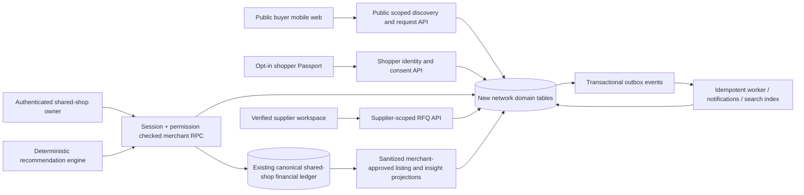
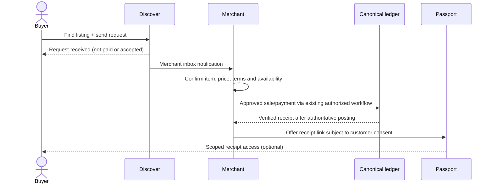

# Tallybook Connected Commerce — technical architecture
**Version:** proposed 1.0, 2026-11-18 • Five equal product tracks: CC-D / CC-N / CC-S / CC-C / CC-P.  
**This file is an engineering design, not a claim that the APIs or tables already exist.**

## 1. Existing boundaries and reuse map
| Existing repository component | Current role | Proposed integration |
|---|---|---|
| `client/src/cloud/shopClient.ts`, `SharedShopPage.tsx` | authenticated shared-shop client/shell | merchant-side typed clients and navigation |
| `client/src/cloud/shopPublicOrders.ts`, `client/src/pages/PublicShopOrderPage.tsx` | public catalogue + guest order REQUEST | extend only with explicit new opt-in discovery publication; preserve request-not-sale semantics |
| `client/src/cloud/SharedShopPurchasingPanel.tsx`, `shopPurchasing.ts` | authorized purchase flows | supply RFQ review → existing owner PO mutation after new integration gates |
| `client/src/cloud/shopAssistant.ts`, `SharedShopAsk.tsx`, `client/src/features/assistant/` | role-safe read-only answers and drafts | deterministic insights, guarded suggestions, action diff/approval |
| `client/src/cloud/SharedShopOrders.tsx`, `SharedShopReports.tsx` | owner operations and reports | attribution, accepted offer / fulfillment and verified outcome views |
| `supabase/migrations/` | canonical server business state and authorization RPCs | additive new isolated network tables/RPCs, no destructive rewrite |
| `README.md`, `docs/release/REMOTE_VERIFICATION_2026-11-16.md` | local/hosted differences and pilot gates | retain independent offline, deployment and real-device acceptance |

**Critical:** a standalone device ledger in IndexedDB is not a network participant simply by existing. Require independently authenticated membership in a shared shop and an explicit publish/import workflow with owner review. Never silently replicate local customers, financials or stock to the network.

## 2. Proposed logical topology

**Architecture principle:** *network coordination is separate from merchant accounting*. All financial sale posting, refunds, receiving, expense, supplier settlement and stock changes remain in existing canonical authorized services. Add *projections* and a read-only network domain, never a second mutable financial truth.

## 3. Domain services and aggregates
| Track | Domain aggregate (proposed) | Authorized writer(s) | Public exposure |
|---|---|---|---|
| CC-D | `listing`, `listing_snapshot`, `buyer_request`, `request_attribution` | owner publishes; buyer submits bounded request; owner confirms | sanitized display listing, availability label/age, bounded request receipt |
| CC-N | `network_enrollment`, `partner_offer`, `referral`, `referral_terms`, `fulfillment_evidence` | enrolled owners by explicit workflow | no merchant-private rows; buyer sees only agreed handoff |
| CC-S | `supplier_profile`, `rfq`, `quote`, `group_intent`, `po_link` | buyer-owner/supplier separate roles | opt-in supplier information only |
| CC-C | `insight_snapshot`, `suggestion`, `decision`, `draft_action` | deterministic server rules + permitted owner; model cannot post | none by default |
| CC-P | `shopper_identity`, `consumer_consent`, `receipt_grant`, `claim`, `loyalty_program`, `reward_event` | shopper / merchant according to scope | single token-scoped receipt preview, no public directories |

Primary keys: server-generated UUIDs; each merchant-owned row has company/store scope and security proof; network joins reference **approved** public membership, not unrestricted business IDs. Use append-only `audit_events` with actor, server time, operation key, outcome and redacted reason. Use money in minor units with ISO currency code; BigInt/NUMERIC server arithmetic, never implicit float comparisons.

## 4. Proposed server contracts — NOT existing endpoints
Keep existing versioned `tallybook_*` RPC security conventions (explicit grant, fixed search path, canonical session authorization, tenant-scoped results). Do not expand the privileges of `tallybook_guest_order` without redesign/review.

| New logical action | Actor | Parameters (illustrative) | Result / invariant |
|---|---|---|---|
| `discover.publish_listing` | owner | store, product, public fields, expectedVersion, operationKey | new version; owner opt-in; no private data |
| `discover.search` | anonymous | query, area, filters, cursor | bounded sanitized results, freshness stamps |
| `discover.request` | anonymous | listingVersion, quantity, contact consent, operationKey | request only; NO payment/stock hold |
| `network.send_offer` | enrolled partner | referralId, price/expiry, terms, operationKey | offer visible to originating owner, no secret stock |
| `network.accept_terms` | two relevant authorized owners | contractVersion, agreement, operationKey | immutable accepted terms; idempotent |
| `supply.create_rfq` | owner | normalized item/qty/unit/delivery, operationKey | RFQ; NO PO or receipt yet |
| `supply.submit_quote` | verified supplier | rfqId, unitPriceMinor, taxes, freight, MOQ, expiry | normalized comparable terms |
| `clementia.get_insights` | authorized staff | approved scope, period, cursor | source-tagged data + permissions; read-only |
| `clementia.confirm_draft` | owner | draftId, expectedLedgerVersion, operationKey | existing service applies authorized mutation or fails |
| `passport.grant_receipt` | qualified merchant/shopper | verified receiptId, consent scope, expiry | scoped receipt token; not open sale history |
| `passport.open_claim` | receipt owner | receipt grant, issue type, operationKey | claim ticket; no refund posting |
| `passport.redeem_reward` | shopper + merchant verification | programVersion, eligible receipt, operationKey | exactly-once merchant-perk event |

Each contract needs JSON schema, auth and negative tests, rate caps, pagination, structured error codes (`NOT_AUTHORIZED`, `NOT_FOUND`, `STALE_VERSION`, `NONCOMPARABLE_QUOTE`, `REQUIRES_CONFIRMATION`, `NOT_SETTLED`, `RETRY_SAFE`), replay rules, owner abort/compensation and an idempotency expiry/retention policy.

## 5. Source and schema placement proposal
- Merchant React features: `client/src/features/connectedCommerce/{discover,network,supply,clementia,passport}/`; public routes: `client/src/pages/` with lazy, separate guest shell; keep existing shared-shop flows intact.
- Typed domain clients: `client/src/cloud/connectedCommerce/` with a file per track; audit `shopClient` before reuse so guest vs owner calls cannot share credentials accidentally.
- DB: new chronological additive migrations in `supabase/migrations/` prefixed after most recent migration; follow project naming policy and maintain corresponding tested rollback/forward migrations. **Never insert guessed filenames or backdate migrations.**
- Tests: independent unit/contract tests, disposable PostgreSQL auth/RLS tests, Playwright PWA/mobile routes in `qa/`, and CI guard steps; test every new permission denial.
- Documentation: each PR updates these specs, actual source paths, data flows, threat model and pilot evidence, without overwriting stage 21–32 status.
- No general-purpose external AI browser key or merchant secrets in public bundles. API keys/server credentials stay server-side.

## 6. Cross-track events (outbox, not unverified mutations)
**Proposed event types:** `listing.published.v1`, `listing.unpublished.v1`, `buyer.requested.v1`, `merchant.request_confirmed.v1`, `referral.terms_accepted.v1`, `referral.fulfillment_confirmed.v1`, `rfq.created.v1`, `supplier.quote_recorded.v1`, `insight.reviewed.v1`, `sale.receipt_verified.v1`, `claim.resolved.v1`, `reward.redeemed.v1`.

Events emitted only **after authoritative transaction commit** with stable IDs, versioning, tenant scope and minimal payload. Consumers are at-least-once, idempotent, replay-safe and eventually consistent; do not treat search projections as a proof of payment or reserved inventory.

Example cross-track happy path (no unapproved financial jump):

## 7. Data, privacy and security architecture
- **Actor trust:** `anon_guest`, `shopper`, `merchant_owner`, `merchant_staff`, `verified_supplier`, `operations_moderator`; roles are distinct, no ambient global admin views. Supplier status is not merchant owner authority.
- **Permissions:** enforce server-side for reads and writes, including RLS/SECURITY DEFINER audits and negative access matrices. Merchant B never reads Merchant A's invoices, cost, customers, debtor records or stock balance.
- **Consent records:** purpose-scoped, actor-scoped, versioned, revocable and retained with legally reviewed retention. No silent cross-shop customer graph, no default GPS, no unconsented SMS/WhatsApp marketing.
- **Public abuse:** enumeration controls, per-IP/account/token rate limits as applicable, captcha/risk challenge where needed, link revocation and content moderation without exposing admin identity.
- **Location:** user-selected area first; optional coarse geolocation with express choice, short retention; merchant addresses verified before map pins; do not claim an exact distance from missing coordinates.
- **Payment boundary:** payment provider integration is a separate approved subsystem with signed webhook, ledger reconciliation, provider fees/chargebacks, refund policy and license/legal review. Never route network requests directly to paid states.
- **Receipts and loyalty:** receipt authenticity derived from canonical recorded sale and server-signed opaque token; no transferable points as currency without regulatory approval.
- **AI:** evidence retrieval only from authorized scope; untrusted product text cannot command system actions; validation before every proposed action; prompt-injection evals, rate limits, explainability; no action when confidence/authority insufficient.
- **Data protection:** Ghana Data Protection Act applicability/privacy review, payment/advertising/consumer-protection checks with counsel. Do not imply legal compliance merely because a checklist exists.

## 8. Failure modes, consistency and rollback
1. **Offline listing:** show "last checked" and discourage unverified purchase promises; queue only safe draft actions; no network claim without server acknowledgment.
2. **Double submission:** stable client-generated operation key + server uniqueness + replay returns same receipt; mismatched payload with same key rejects.
3. **Concurrent partner acceptance:** transactionally lock referral/offer version; exactly one final contracting route per accepted handoff or explicit split approved.
4. **Quote expiry:** snapshot exact quote version and landed cost; no automatic PO after expiry; require owner reconfirmation.
5. **AI stale insight:** revalidate authoritative product/ledger versions; fail closed with refresh prompt.
6. **Receipt grant abuse:** short-lived scoped token, replay/rotation policy, authenticated view for sensitive details; log suspicious accesses without raw secrets.
7. **Index/worker outage:** merchant operations remain on canonical ledger; public search may degrade to last-verified labels/temporary unavailable, not fake data.
8. **Schema rollout:** additive reversible where safe; when data makes rollback unsafe, block destructive rollback and use a forward repair. Full isolated restore rehearsal and staged releases.

## 9. Quality gates
- Unit + type/build; contract/schema negative access tests in disposable DB; integration tests across each event boundary; all existing POS/finance/inventory regression gates remain green.
- Playwright mobile 320/360/390px, keyboard/screen-reader behavior, offline/no-network, reconnect, reload/idempotency, slow Android, CSRF/XSS/CSP, broken JWT and token replay tests.
- Security/privacy review with production-like Auth; real two-phone owner/attendant testing; supplier and consumer real-account field test; proof of rollback, monitored error/latency budgets and observability with **no raw PII in logs**.
- No broad rollout until each track passes its own gate and shared cross-track security tests; feature flags allow independent shutdown.

[Master](00_START_HERE_MASTER_SPEC.md) · [PRD](01_PRODUCT_REQUIREMENTS_PRD.md) · [UI](03_UI_UX_INTERFACE_DESIGN.md) · [Roadmap](04_IMPLEMENTATION_ROADMAP_AGENT_PLAYBOOK.md)
