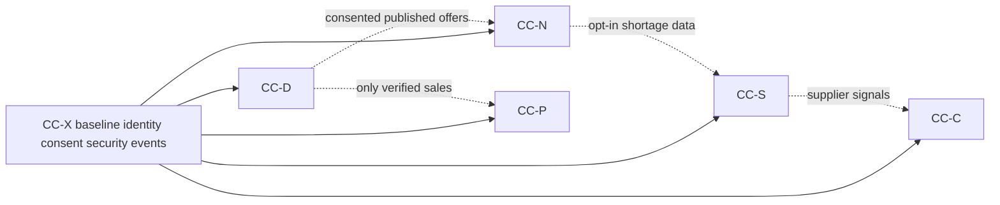

# Tallybook Connected Commerce — roadmap and coding-agent playbook
**Status:** Proposed plan; documentation-only as of 2026-11-18.  
**Rule:** Five initiatives **equally important**. No ordering below denotes reduced strategic importance. Execution may sequence dependent changes for safety. This plan is ADDITIVE and does not supersede `road-to-complete.md` Stages 21–32.

## 1. Delivery topology
Use a shared **CC-X** platform/security group and five equally staffed feature tracks: **CC-D Discover, CC-N Business Network, CC-S Supply, CC-C Clementia 2.0, CC-P Passport**. All five receive a dedicated accountable lead, complete PRD coverage, clickable prototype, secure server contract, tests, acceptance report and pilot; do not ship 3 and defer 2 without an explicit documented product decision.

Plan timeboxes are **planning proposals**, not delivery promises. Stop a phase at a failed safety/acceptance gate; continue other independent tracks only if compatible.

## 2. Work packages — parallel milestones
| Phase / exit condition | CC-D Discover | CC-N Network | CC-S Supply | CC-C Clementia | CC-P Passport |
|---|---|---|---|---|---|
| **0. Discovery / evidence** | validate shopper finding + merchant willingness | validate inter-shop shortage/referral agreements | collect supplier quoting/units/landed costs | evaluate accuracy of existing financial/stock signals | test receipt privacy, warranty, reuse and rewards |
| **1. Clickable prototype / UX review** | search/listing/request flow | request/offer/two-party-accept flow | RFQ/quote/compare/approve flow | insight/evidence/draft/confirm flow | guest receipt/opt-in/claims flow |
| **2. Contracts / security implementation** | sanitized listings + scoped requests | partner enrollment + referral terms | supplier/RFQ/quote + comparison | deterministic engine + permission safe draft | consent/receipt grants/claim state |
| **3. Integrated pilot** | verified conversion evidence | real fulfilled referrals | verified landed-cost savings | measured useful safe suggestions | repeated receipt/claim use |
| **4. Controlled scale** | regional coverage + relevance | service areas + reputation evidence | supplier breadth + opt-in pooling | wider evaluated signals | cross-merchant benefits only by opt-in |

### Shared prerequisites (CC-X)
- **CC-X-0:** pin actual main SHA, CI, deployed commit, schema migration map and working authorization policy; reconcile Stage 21 baseline before new change.
- **CC-X-1:** consent versions, merchant verification status, new scope/roles, separate guest and shopper auth, privacy retention policy.
- **CC-X-2:** stable operation keys, events/outbox, typed contracts, redacted telemetry, opt-in service flags and kill switches.
- **CC-X-3:** case management for platform abuse/reporting, account/recovery, privacy requests, incident response and support runbook.
- **CC-X-4:** legal/partner review for payments, consumer rights, Ghana privacy and supplier contracting before anything regulated.
- **CC-X-5:** design-system primitives and common accessibility, slow-network, status and testing harness for all tracks.
No new schema may weaken existing canonical shop ownership/staff scope or migrate local IndexedDB data silently.

## 3. Engineering task list & completion checks

### CC-D — Discover
- [ ] `CC-D-01` competitor and pilot benchmark; identify merchant/shopper retention triggers.
- [ ] `CC-D-02` owner-permissioned publishing UI; sanitize projection; unpublish/revoke.
- [ ] `CC-D-03` indexed public search with user-selected area; no assumed GPS.
- [ ] `CC-D-04` request and merchant response with honest availability/price state.
- [ ] `CC-D-05` attribution from request → canonical confirmed fulfillment; no synthetic sale count.
- [ ] `CC-D-06` security and real merchant/buyer pilot; acceptance evidence.
**DoD:** listing doesn't leak inventory counts or costs; buyer can request without app; no `paid` label absent settlement.

### CC-N — Business Network
- [ ] `CC-N-01` partnership/commission/dispute policy and verification definitions.
- [ ] `CC-N-02` owner opt-in + restricted partner directory and shortage request.
- [ ] `CC-N-03` partner quote response, expiry and immutable two-party acceptance.
- [ ] `CC-N-04` fulfillment evidence + cancellation and dispute workflows.
- [ ] `CC-N-05` tenant isolation, version locking, duplicate/replay tests.
- [ ] `CC-N-06` partner pilots and audited completed handoffs.
**DoD:** one active accepted handoff per request unless explicitly split; two owners' verified consent; no cross-tenant private data.

### CC-S — Supply
- [ ] `CC-S-01` validate buying terms, delivery variability, supplier verification criteria.
- [ ] `CC-S-02` reviewed RFQ drafting and supplier quote submissions.
- [ ] `CC-S-03` exact normalized landed-cost comparison and explainability.
- [ ] `CC-S-04` owner PO authorization integrated with canonical purchasing; no automatic goods receipt.
- [ ] `CC-S-05` optional private aggregate purchasing groups and anti-collusion/privacy/legal assessment.
- [ ] `CC-S-06` supplier/merchant pilots measuring net rather than gross savings.
**DoD:** comparable units/tax/freight; no PO/stock movement without owner approval and actual receiving.

### CC-C — Clementia 2.0
- [ ] `CC-C-01` baseline existing `shopAssistant.ts` and held-out eval suite; identify provable insight types.
- [ ] `CC-C-02` deterministic read-only signal and freshness/provenance engine.
- [ ] `CC-C-03` evidence card UI, role-limited scope, recommended owner-reviewed draft.
- [ ] `CC-C-04` authorized confirm with revalidation and same existing posting service.
- [ ] `CC-C-05` prompt injection, stale data, role denial and financial oracle tests.
- [ ] `CC-C-06` measure actionable recommendations and user benefit, not "AI conversations."
**DoD:** no model-created source of truth, no autonomous posting, all suggestions traceable and revocable where underlying operation allows.

### CC-P — Passport
- [ ] `CC-P-01` privacy/consent model and legal retention review.
- [ ] `CC-P-02` verified receipt token service; guest and optional shopper capture.
- [ ] `CC-P-03` shopper receipts, export, revoke and account recovery.
- [ ] `CC-P-04` claim/return/warranty requests linked to merchant policy and actual events.
- [ ] `CC-P-05` merchant perks rules + reward ledger/idempotent redemption, not stored value.
- [ ] `CC-P-06` real buyer/merchant pilot and safe support process.
**DoD:** verified proof only, no cross-store profiling without consent, refund status never inferred from claim, no double rewards.

## 4. Dependencies without strategic deprioritization

Dotted cross-feature integrations are **optional** in initial pilot. Build each track's stand-alone value through its own valid workflow rather than making a project fail if another track is unfinished. Share domain infrastructure; avoid copy/paste API gateways or new duplicated ledgers.

## 5. PR and agent workflow (mandatory)
1. Read `README.md`, `road-to-complete.md`, `docs/release/PRODUCTION_STATUS_2026-11-15.md`, `docs/release/REMOTE_VERIFICATION_2026-11-16.md` and all five specs in this folder. Inspect actual main and deployment again; dates are evidence snapshots.
2. For every task, write an **implementation map**: current file/function/RPC, proposed file/module/migration, source of truth, actor permissions, UI states, rollback approach and affected tests. If an existing feature already solves it, extend it; don't duplicate.
3. Work in feature branch `feat/cc-<track>-<slice>`; protected main stays review-only. One independently testable slice per PR, include migration only when code/compatibility gates and isolated rollback prove safe.
4. Include feature flags OFF by default; do not turn on live payment gateways, messaging sends, public listings or AI posting on deploy.
5. Unit/contract test with synthetic data → disposable DB auth negative tests → full existing build/test gates → Playwright real flows & offline → security/privacy review → two-device human acceptance.
6. Include **5-track regression matrix** in every cross-cutting PR to show no breakage and keep shared services stable.
7. Merges/deployments require owner approval for schema, money, auth, public data exposure, regulated processing and production rollout. No force push or destructive wipe.
8. Track results with evidence links and source hashes; documentation status must say `planned`, `source implemented`, `CI verified`, `isolated pilot verified`, `production accepted` distinctly.

### PR template
```markdown
## CC track / requirement IDs
## Existing source reused and files changed
## User journey and screenshots (mobile + desktop)
## Data ownership, consent and tenant/role matrix
## State machine and idempotency/rollback
## Migration compatibility + no destructive data changes
## Evidence: tests, CI, a11y, privacy, failure, pilot
## Effects on the other four CC tracks
## Blockers, manual field acceptance, feature flag status
```

## 6. Gates and project-level definition of done
| Gate | Evidence required | Exit |
|---|---|---|
| G0 — baseline | exact main vs deployed source + database schema; old Stage 21–32 obligations assessed | no unknown release baseline |
| G1 — discovery | each track has user problem, prototype test, pricing/value hypothesis | five independently reviewable concept reports |
| G2 — design/security | each UI complete states + signed actor/consent matrix + failure modes | privacy and schema design reviewed |
| G3 — engineering | complete feature source, unit/types, disposable PostgreSQL authorization tests, full existing POS test suite | no regression or unapproved mutation |
| G4 — release candidate | mobile browser, screen reader, offline/replay, audit/metrics, restore and rollback evidence | each track safe to pilot with owner signoff |
| G5 — field learning | real merchants/buyers/suppliers as applicable, recorded task outcomes, accurate money and value calculations | independently evaluated five scorecards |
| G6 — scale review | security, consumer protection and payment approval where relevant; performance, unit economics, support capacity | incremental opt-in rollout with kill switches |

**Complete program** means ALL FIVE meet their own G5 and approved G6 criteria plus CC-X shared acceptance, with evidence for their results. A feature that only renders a screen, passes unit tests, or has untested payment/supplier claims is not complete.

## 7. Risk register and decision points
- Marketplace cold start: empty search → area-focused opt-in pilot, but do not invent stock or attract customers with fake merchant listings.
- Fraud/referral disputes: records, who owes whom, and explicit handoff agreements; don't hold customer funds.
- Data leakage: tenant/role negative tests and independent security review before live rollout.
- Supplier price volatility: quote expiry and landed-cost version checks, not stale automated purchasing.
- Assistant confidence: precise source and deterministic validation, never autonomous financial posting.
- Shopper identity/privacy: opt-in, no purchased-data aggregation without purpose, recovery and deletion requests.
- Commercial risk: merchants may have strong existing tools; trial/import must be safe, and sustained measured merchant value—not downloads—drives go/no-go.

## 8. Immediate tasks for next coding agent
1. Read all files in this folder; create five feature epics and one platform epic with requirement IDs and acceptance mapping; do NOT start with feature coding before baseline reconciliation.
2. Verify fresh repository and production status; do not assume this document authorizes any production migration or payment integration.
3. Produce clickable low-data 320px mobile prototypes for ALL FIVE journeys, with server contracts/role maps and test matrices; do not bias resources toward Discover/Network/Supply.
4. Propose smallest vertical slice for each track with comparable effort and explicit risk gates, then implement only through reviewed PRs.
5. Keep existing ledgers, Clementia authorization, public guest-order limitations and the approved Stage 21–32 roadmap intact.

[Master](00_START_HERE_MASTER_SPEC.md) · [PRD](01_PRODUCT_REQUIREMENTS_PRD.md) · [Architecture](02_TECHNICAL_ARCHITECTURE.md) · [UI](03_UI_UX_INTERFACE_DESIGN.md)
